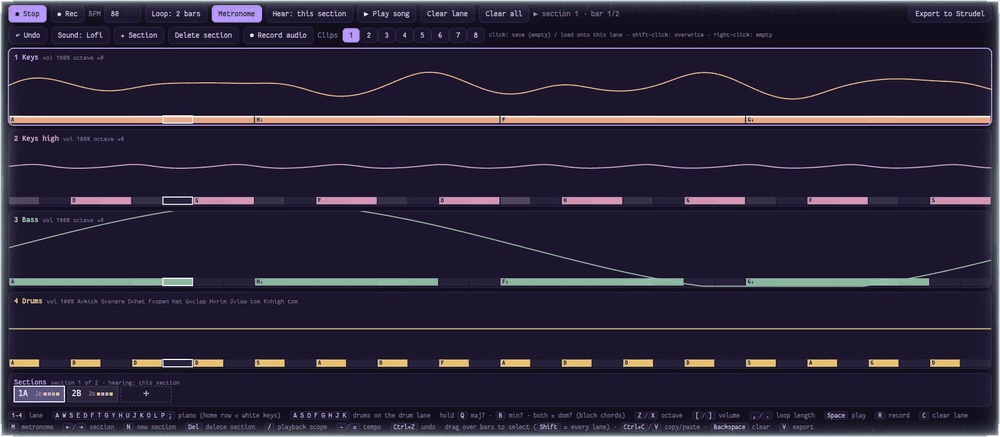

# Thumbloop

A loop sketchpad you play with a **game controller** (or your laptop keyboard). Hold a button, hear a note;
hit record, and it loops. Four lanes, each with a live scope. Stack them up, string loops into sections,
and export the result as [Strudel](https://strudel.cc) code.

It is one HTML file. No install, no build, no accounts: open `index.html`.

## What it is (and isn't)

- **Is:** a fast way to get a musical idea out of your head and into a loop, without knowing music theory.
  The controller plays a pentatonic scale, so there are no wrong notes. Hold a trigger and a button plays a whole chord.
- **Isn't:** a DAW, or a serious tracker. There is no mixing or effects, and the sounds are small synths, not samples.
  Play several notes at once and they are all recorded (a kick and a hat on the same step, say); overlapping notes
  come out as stacked layers in the Strudel export.

## Run it

1. Open `index.html` in Chrome or Brave (the controller uses the Gamepad API).
2. Click the page or press a key once. Browsers keep audio off until then.
3. Optional, for the real drum sounds: `python3 tools/fetch-samples.py`. It downloads the TR-909 kit into
   `drums.js`. Without it the drums are a synthesized noise kit.

Volume and octave are per section: each section keeps its own lane volumes and the octave each lane plays in, and switching sections (or playing the song) uses them. Old songs start every section from the song-wide volumes they had.

Songs are saved automatically in the browser (localStorage), on this device only. Click the song name at the top
left (or **Ctrl+O**) to see all your songs: open, rename, duplicate, delete, or start a new one in any sound set.
Browser storage can be wiped, so **Ctrl+S** (or *Save backup file*) downloads the current song as a small `.json` file,
and *Open file* loads one back.

## Where things live

It's plain scripts, no build step, so it still opens by double-click.

| File | What's in it |
|---|---|
| `sounds.js` | sound sets and their lanes, drum voices, tempo and loop constants |
| `controls.js` | **every key and controller button**, with named buttons (`A`, `LB`, `START`…) |
| `audio.js` | the output chain, voices and drums |
| `songs.js` | the song library, saving, cleaning imported songs |
| `play.js` | playback, undo, bar selection, every action |
| `input.js` | keyboard and gamepad handling |
| `export.js` | Strudel and MIDI export |
| `index.html` | the page, its styles, the UI and the drawing code |

## Sound sets

| Set | Lanes | Feel |
|---|---|---|
| **NES chiptune** | 2 pulse, triangle, drums | NES-style voices. Chords are fast arpeggios (one voice, like the real chip). |
| **Lofi** | electric piano, high piano, bass, drums | FM electric piano with 7th chords, 80 bpm. |
| **Synthwave** | lead, pad, bass, drums | Detuned saws and a square sub, 100 bpm. |
| **Ambient** | pad, bells, drone, percussion | Slow pads and bell tones, 70 bpm. |

Switch with the **Sound** button, or **L3** on the controller. Each song remembers its own set; pick the set for a new
song in the Songs panel.

**Adding your own set:** a sound set is one entry in the `SOUNDS` list at the top of `index.html`: a name, a tempo, how
chords sound, and its lanes. A lane can use any number of lanes per set, and the `synth` voice is built purely from
settings (oscillators, filter, envelope), so a new set needs no new code.

## Making a song

- **Record:** press Record, wait out the 4-beat count-in, play. It loops and keeps layering.
- **Sections:** the strip along the bottom is your song. The section you select *is* the loop you play on.
  Click `+` to add one (a copy of the one before, so you can vary it). **Drag** a section to reorder it, drop it on the
  copy icon to add a duplicate at the end of the song, or drop it on the bin to delete it.
- **Hear:** what plays while you work, cycled with the **Hear** button (or LB): this section, the previous one first,
  the song up to here, or the whole song (playback only, no recording).
- **Bars:** drag over bars to select them (Shift = every lane), Ctrl+C / Ctrl+V to copy, even into another section.
- **Clips:** eight slots (bottom right) for single-lane loops you want to reuse.
- **Undo:** Ctrl+Z, the Undo button, or hold RB. It covers clears, recordings, pastes and section changes.

## Controls

**Controller** (the standard layout, such as an Xbox pad)

| Input | Does |
|---|---|
| D-pad + X A B Y | notes (drums on the drum lane; D-pad = clap, rim, toms) |
| hold RT / LT | major / minor chord (lofi: maj7 / min7, both = dom7) |
| Left stick up/down, left/right | volume, octave |
| Right stick up/down | change lane; one past the last lane is the sections row (D-pad left/right pick, A new, X delete, hold Y + left/right move, B back) |
| Right stick left/right | change section (past the last = a new one) |
| LB tap / LB + right stick left/right | cycle what you hear / tempo |
| RB tap / hold | clear lane / undo |
| Start / View | record / play |
| L3 / R3 | sound set / metronome |

**Keyboard**

| Keys | Does |
|---|---|
| `A W S E D F T G Y H U J K O L P ;` | piano (home row = white keys). On the drum lane: `A S D F G H J K` |
| hold `Q` / `B` | major / minor chord |
| `1`-`4` | lane |
| `Z` `X` / `[` `]` / `,` `.` | octave / volume / loop length |
| `Space` `R` `C` `M` | play, record, clear lane, metronome |
| `←` `→` `N` `Del` | section: previous/next, new, delete |
| `/`  `-` `=` | what you hear, tempo |
| drag, `Ctrl+C`, `Ctrl+V`, `Backspace` | select, copy, paste, clear bars |
| `Ctrl+O` / `Ctrl+S` | songs panel / save a backup file |
| `V` | export |

Want different keys? The controls live in one table at the top of `index.html` (`KEYMAP` for the keyboard, `PADMAP`
for the controller, `DO` for what each action does). Change a key there and the on-screen help follows.

## Export to Strudel

**Export to Strudel** (or `V`) turns your song into [Strudel](https://strudel.cc) code: one `stack(...)` per
distinct section, then an `arrange(...)` of the whole song. Paste it into Strudel, or use the **Open in Strudel**
button. Strudel's own sounds are used there, so it will sound a little different (usually richer).

The export window also has **Download .mid**: a standard MIDI file with one track per lane, the sections in order, and
the drums on channel 10 (General MIDI). Open it in any DAW or synth. Chords are written as simultaneous notes, and the
sounds are whatever your synth gives the tracks (the notes carry over, the NES/lofi voices don't).

**Record audio** saves what you hear as a `.webm` file, if you want to share a track.

## Notes

- Tested in Chrome/Brave on Linux. Other browsers should work, but they have not been tried.
- Strudel's `gm_epiano1` is used for the lofi keys in the export, so it needs an internet connection the first time.
- Samples: the TR-909 drums come from [tidal-drum-machines](https://github.com/ritchse/tidal-drum-machines),
  which has no license, so they are downloaded by you and not included in this repo.

## License

MIT, see [LICENSE](LICENSE). The drum samples are not covered by it (see Notes).
